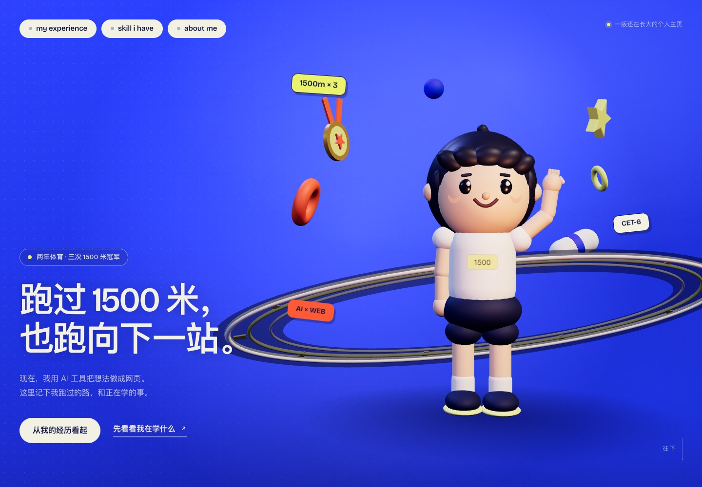
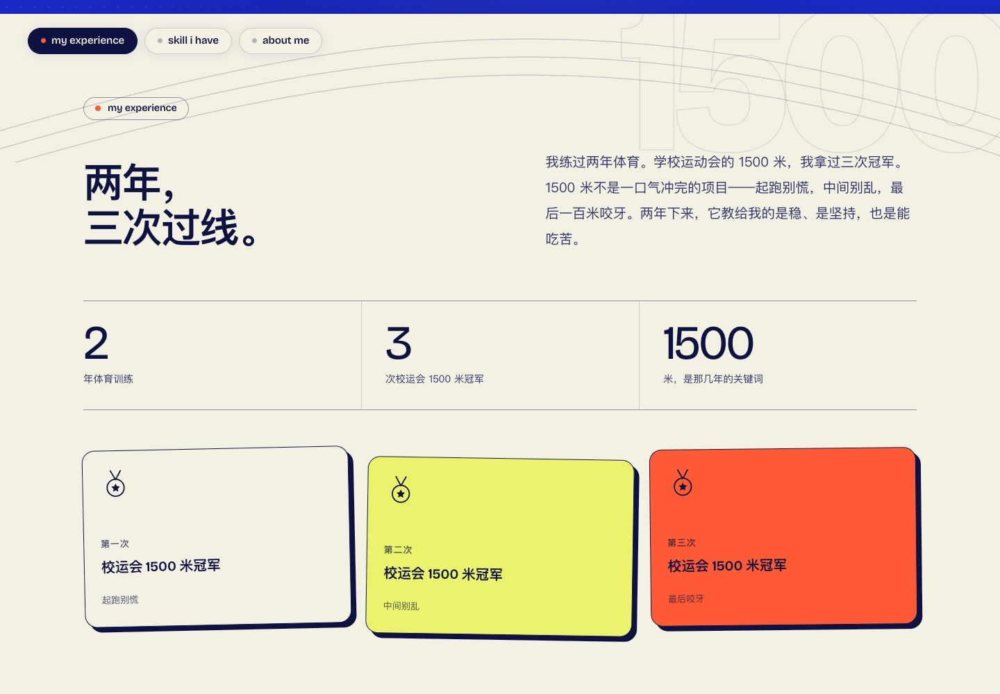
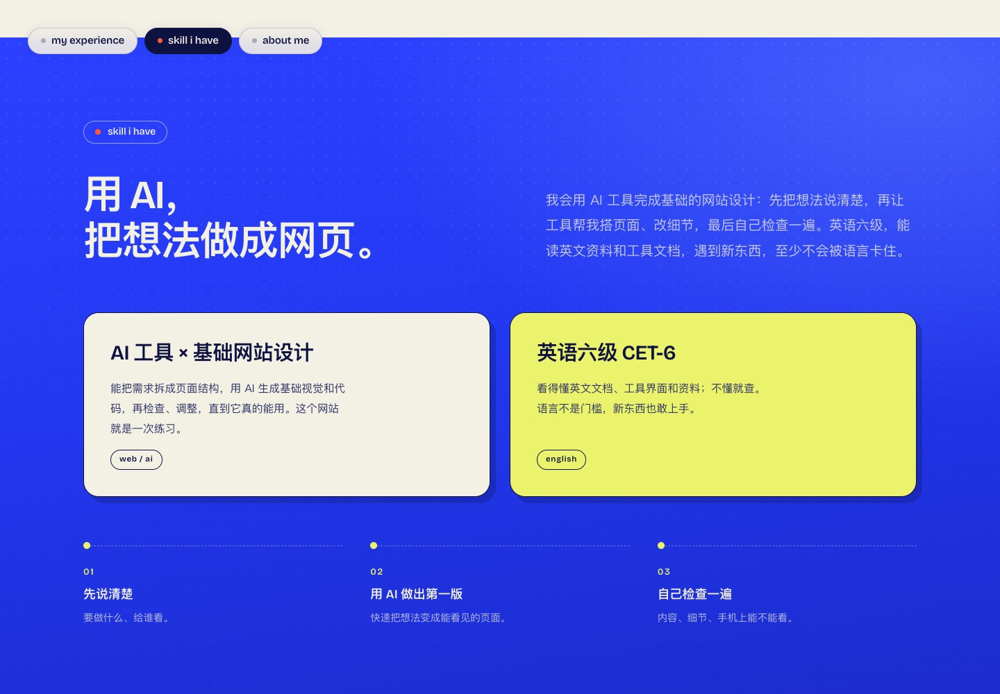

# 1500 米之后 · 个人主页

一个带手写 3D 首屏的静态个人网站。蓝色电光底 + 一个微笑的 3D 少年 + 三条可交互的导航按钮。

## 打开方式

- 直接双击 `index.html` 即可离线浏览（3D 场景已打包为普通脚本，不依赖模块加载）。
- 要发布到公网：看 [DEPLOY.md](DEPLOY.md)，根目录另有可直接上传的 `1500米之后-部署包.zip`。
- 或在本目录运行本地服务：`python3 -m http.server 8090`，打开 <http://127.0.0.1:8090/>。

## 预览







移动端首屏与三个子页见 `assets/preview/`。

## 页面

| 页面 | 内容 |
| --- | --- |
| `index.html` | 3D 首屏（可直接滚动阅读三个段落）、三按钮按顺序滚动、段落可跳转到独立页面 |
| `experience.html` | my experience：两年体育、三次校运会 1500 米冠军 |
| `skills.html` | skill i have：AI 工具 × 基础网站设计、英语六级 CET-6 |
| `about.html` | about me：能吃苦、持续学习、愿意用新工具 |

三个按钮在首页会按顺序滚动到对应段落；在每个独立页面里则直接跳到对应页面。每个段落底部也有“打开完整页面”的入口。

## 交互与无障碍

- 首屏少年会呼吸、挥手、眨眼，鼠标移动时轻微视差；支持 `prefers-reduced-motion`，开启后为静止画面。
- 3D 不可用时自动显示静态降级图 `assets/img/hero-fallback.jpg`。
- 键盘可用的焦点样式、跳到主内容链接、语义化标题、装饰元素 aria-hidden。
- 移动端 390px / 桌面 1440px 均已自检，无横向滚动。

## 技术说明

- Three.js r161（`assets/vendor/three.module.js`），3D 少年、跑道环、奖牌、星星等全部由基础几何体在 `assets/js/hero3d.js` 中手写生成，不使用外部模型或图片。
- 修改 `assets/js/hero3d.js` 后重新打包：

```bash
/tmp/dsh-npm-cache/_npx/7bbf1cbb8e5ae33e/node_modules/esbuild/bin/esbuild \
  assets/js/hero3d.js --bundle --format=iife --target=es2020 --minify \
  --legal-comments=none --outfile=assets/js/hero3d.bundle.js
```

- 字体：Bricolage Grotesque（OFL，已内嵌为 base64 写入 `base.css`，双击本地文件也能正常显示；原始文件保留在 `assets/fonts/bricolage.woff2`）+ 系统中文字体 PingFang SC。
- 配色：电光蓝 `#2238f0`、墨蓝 `#0d1240`、米白 `#f3f0e4`、柠檬黄 `#eaf36b`、橙红 `#ff5a36`。
- 内容来源与文案约定见 `CONTENT.md`。

## 文件结构

```
portfolio/
  index.html / experience.html / skills.html / about.html
  CONTENT.md / DEPLOY.md / README.md
  .nojekyll / robots.txt
  assets/
    css/base.css     共用设计系统
    css/home.css     首页 + 3D 首屏
    css/pages.css    三个子页面
    js/home.js       首页滚动与导航高亮
    js/hero3d.js     3D 场景源码（打包后由 bundle 加载）
    js/hero3d.bundle.js
    js/pages.js      子页面交互
    img/hero-fallback.jpg            # 1440 降级图
    img/hero-fallback-tablet.jpg    # 768 降级图
    img/hero-fallback-mobile.jpg    # 390 降级图
    preview/                        # README 与交付预览截图
    fonts/bricolage.woff2
    vendor/three.module.js
```

## 部署

见 `DEPLOY.md`：Netlify Drop（最快）、GitHub Pages（免费长期）、腾讯云 COS / 阿里云 OSS（国内速度）、自有服务器 Nginx，以及同 Wi‑Fi 手机预览。

生产上传只需：4 个 HTML + `assets/css` + `assets/js`（`hero3d.bundle.js`、`home.js`、`pages.js`）+ `assets/img` 三张降级图 + `assets/favicon.svg`。根目录的部署包已按此整理（约 1 MB，已通过子路径部署实测）。
